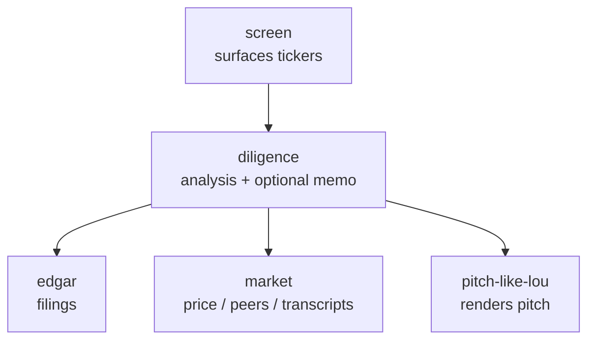

# MAP.md

Where things live and how data flows. Read before touching structure or data flow.

## Repository shape

A dual-harness repository packaging five self-contained equity research skills as both an
Antigravity plugin and a Git Pi package from a single source of truth under
`agents/secstack/skills/`.

```text
.antigravity-plugin/
  plugin.json           Antigravity plugin manifest (skills 0 · agents 1 -> zero global bleed)
agents/secstack/
  agent.md              Antigravity bare main agent (excludeDefaultComponents, 7 tools)
  worker.md             Private bare leaf worker for run_workflow (6 tools)
  skills/               Single source of truth for research skills + Antigravity workflow guide
    screen/             Discovery — scan the universe, surface tickers
    edgar/              Data — SEC EDGAR filings, ownership, 13F holders
    market/             Data — price, peers, transcripts (Yahoo Finance)
    diligence/          Analysis — one operating company -> scoped answer or memo
    pitch-like-lou/     Voice — finished thesis -> VIC-style pitch
    run-workflow/       Antigravity-only workflow guide (excluded from Pi package.json)
package.json            Pi package manifest pointing pi.skills at the five research skills
SYSTEM.md               Pi research-agent identity installed into the isolated Pi profile
extensions/             Pi extensions: restores tool prompt envelope and brands startup header
scripts/bootstrap.mjs   Isolated Pi-profile bootstrap
context/                Agent-maintained project documentation
```

Neither harness exposes `agents/secstack/skills/README.md` as a skill. Pi's `package.json`
exposes only the five research skills and omits `run-workflow`.

## Antigravity plugin data flow

Installing the repository via `agy plugin install` unpacks it to
`~/.gemini/config/plugins/secstack/` and registers only the `secstack` main agent (`mainAgent:
true`, `subagent: false`). Because there is no top-level `skills/` directory and `worker.md` is
co-located under `agents/secstack/`, coding sessions (`Default`, `clean`, `bare`) never inherit
SECstack skills, rules, or subagents.

- `agent.md` runs with `excludeDefaultComponents: true` and `inheritMcp: false` (stripping
  `<artifacts>`, `<communication_style>`, `<user_rules>`, and workspace `.agents/skills/` bleed),
  inlines the compact skill catalog, and resolves `<skills-root>` from workspace/repo/installed
  plugin paths.
- Dependency-backed skill scripts (`screen`, `edgar`, `market`) run via
  `uv run --project` with `UV_PROJECT_ENVIRONMENT` pointed at
  `${XDG_CACHE_HOME:-$HOME/.cache}/secstack/<skill>`, keeping the installed plugin folder clean
  and workspace caches (`./sec-cache/`, `./screen-cache/`, `./transcript-cache/`) beside
  the user's research.
- `run_workflow` spawns `worker.md` (`type_name="worker"`) for horizontal multi-ticker fan-out,
  peer comps, bulk transcript extraction, and independent memo verification (capped at `<= 4`
  concurrent EDGAR workers). Single-company synthesis stays in the primary context.

## Pi profile data flow

The bootstrap configures the isolated profile at `~/.pi/secstack-agent`. Its
`settings.json` owns separate top-level package entries for:

- this SECstack package;
- the filtered `pi-setup` package;
- `pi-system-prompt-viewer`;
- `pi-freeflow`; and
- `agent-browser`.

Pi installs and updates each source independently. The bootstrap manages only those package
entries, the profile's Pi-managed shell path, the `quietStartup` preference, the profile-local
Python environment (synced from `agents/secstack/skills/{screen,edgar,market}`),
and a relative `SYSTEM.md` symlink into the installed SECstack package. The
system-prompt-viewer package is the sole owner of the `/system-context` overlay. SECstack's
`restore-tool-envelope` extension restores Pi's live tool snippets and guidelines after
`SYSTEM.md` replaces Pi's coding-agent identity. Its `startup-header` extension replaces
Pi's built-in header with a responsive, theme-adaptive SECstack research mark and interactive
research pipeline. Coding-task guidance files are not linked, and the filtered `pi-setup` package
contributes no skills, including `repo-nav` and `bootstrap-docs`. Research runs in the primary
Pi context; no sub-agent package is installed. Authentication, model selection, provider
configuration, sessions, and unrelated settings remain profile-local and untouched.

## Skill internals

- `agents/secstack/skills/screen/` — `scripts/scan_insiders.py`, `scan_market.py`,
  `scan_conferences.py`, `search_themes.py`; universe config in `screens.json`; shared
  bootstrap in `scripts/_common.py`.
- `agents/secstack/skills/edgar/` — `scripts/fetch_*.py`, `parse_financials.py`,
  `orient.py`, `list_headings.py`; filing, financial, ownership, proxy/governance, and holdings
  guides in `references/`; shared bootstrap in `scripts/_common.py`.
- `agents/secstack/skills/market/` — `scripts/fetch_market_data.py`,
  `fetch_transcripts.py`, and shared `scripts/_common.py`.
- `agents/secstack/skills/diligence/` — valuation `scripts/dcf.py`, `epv.py`; archetypes
  and guides in `references/`.
- `agents/secstack/skills/pitch-like-lou/` — reference corpus only, no scripts.
- `agents/secstack/skills/run-workflow/` — Antigravity-only `run_workflow` orchestration guide.

## Data flow



- `diligence` selects evidence, reasons over it, and produces the requested analysis or
  full memo. Retrieval contracts and source semantics remain in the data skills.
- The two filing/market data skills know nothing of each other and are swappable.
- `screen` and SEC-facing `edgar` commands read `EDGAR_IDENTITY` and use
  on-disk cache contracts defined in their `_common.py` modules. The SEC skill's routine 13F
  convenience queries use 13f.info and expose underlying SEC periods and identifiers; raw
  EDGAR remains the deep-field and verification route.

## Production order

For a full thesis: `screen` → `diligence` → memo → optionally
`pitch-like-lou`.

For Antigravity and Pi installation workflows, start at the root
[`README.md`](../README.md). For the collection overview, start at
[`agents/secstack/skills/README.md`](../agents/secstack/skills/README.md).
